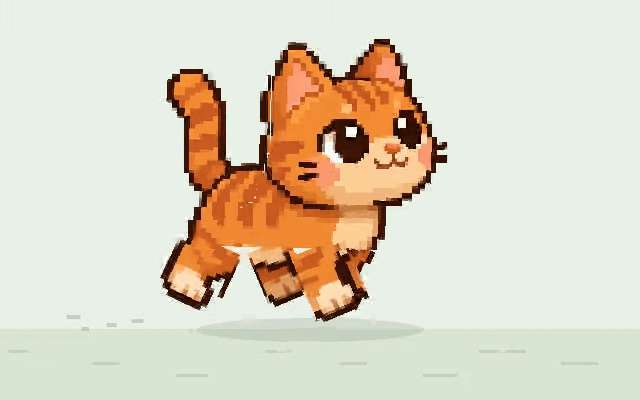

# 巷仔口：一起回家（暫名）

**改版中。** 這個倉庫正從「島與群平台原型」改為「巷仔口：一起回家」（原暫名「貓克敏」）：在日常散步中記下遇見的動物，大家一起讓街頭貓狗回家、讓野生動物回來。12/3 簡報前的工作與之後的階段見 [ROADMAP.md](ROADMAP.md)，待辦都在 [12/3 簡報里程碑](https://github.com/yunching0513/island-pack-prototype/milestone/1)。

線上版：<https://yunching0513.github.io/island-pack-prototype/>。首頁已改成巷仔口，其他畫面仍是島與群原型，會陸續改版。島與群版本保存在標籤 [`v0.3-island-pack`](https://github.com/yunching0513/island-pack-prototype/tree/v0.3-island-pack)。

## 首頁以外的畫面：島與群平台原型

遊蕩犬公民科學與開放資料平台的可操作原型，用於團隊討論，不是正式服務。

討論：每個討論點都有一則 [Issue](https://github.com/yunching0513/island-pack-prototype/issues?q=is%3Aissue+label%3A%E8%A8%8E%E8%AB%96%E9%BB%9E)，網站討論欄的「到 GitHub 留言」會直接連過去。留言需要 GitHub 帳號，內容是公開的。

**頁面上的紀錄、組織與統計都是示例，尚未查核，不代表任何地方的實際情況。** 本版的臺北市里界是真實圖資；未加入道路底圖。安全提示的文字也還沒經專業查核，請勿直接使用。

## 畫面

| 畫面 | 內容 |
| --- | --- |
| 記錄一次相遇 | 四步驟表單，地方知識卡隨位置與填寫內容浮現 |
| 五分鐘觀察 | 定點或固定路線的持續觀察，可送出「未見犬隻」 |
| 看看附近 | 聚合地圖與公開紀錄 |
| 開放資料 | 公開尺度試算、欄位字典、CSV 與 GeoJSON 下載 |
| 管理後台 | 覆核、知識卡、更正與下架 |
| 待決議題 | 第一版範圍建議、原型的假設、資料流程 |

沒有後端。送出的紀錄只存在瀏覽器分頁裡，重新整理就回到初始狀態。

## 本機開啟

```bash
python3 -m http.server 8765
```

然後開啟 <http://localhost:8765>。

## 自動測試

```bash
node tests/e2e.mjs
```

需要 Node 22 以上與 Google Chrome，不用安裝套件。會以無頭 Chrome 點過回家旅程，並檢查 1360、375、320px 的淺色與深色模式都沒有橫向捲動、主控台沒有錯誤。加 `--shots` 會把手機截圖存到 `tests/shots/`。

## 檔案

- `index.html`：樣式與頁面骨架
- `app.js`：地圖、示例資料、畫面與互動
- `content.js`：知識卡、示例紀錄、討論點，修改文字主要在這裡
- `taipei.js`：臺北市 12 行政區、456 里的官方里界（3 公尺簡化）
- `miaoli.js`：舊版苗栗圖資，保留供歷史版本參考，目前不載入
- `motion.html`、`pet-motion.js`：四位像素伙伴、八種動作試玩與 WebM 匯出
- `wildlife.html`：12 種野生動物像素造型候選及參考來源

## 來源與授權

構想屬於島與群，授權待團隊決定。第三方圖資與字體的來源見 [ATTRIBUTION.md](ATTRIBUTION.md)。

## 臺北市首波與角色試玩（2026-11-26）

- 已將首頁、相遇表單、聚合地圖、示例地名與公開尺度移至「臺北市 → 行政區 → 里」。里清單會隨行政區連動；統計仍是示例。
- 里界採臺北市民政局「臺北市里界圖」，2026-09-21 更新，資料收錄迄 2025-06-17。12 區、456 里；以 3 公尺簡化後供介面顯示，不供界址認定。來源與重製方法見 ATTRIBUTION.md、tools/build_taipei.py。
- [角色動作試玩](motion.html)：黃狗、黑狗、橘貓、三花貓；待機、奔跑、吃飯、喝水、喜悅、難過、生氣、愛心。可暫停、調速、轉向、輪播與下載 5 秒 WebM。這是分層骨架的動作草案，尚非逐格手繪定稿。
- [野生動物造型](wildlife.html)：白鼻心、穿山甲、石虎、眼鏡蛇、麻雀、鳳頭蒼鷹，以及黑冠麻鷺、赤腹松鼠、臺灣藍鵲、鼬獾、食蟹獴、山羌。石虎列為全臺擴充候選，不當作臺北野外紀錄。野生動物圖稿尚未由專家審閱，並未全部接入紀錄選單。
- 48×48 的貓狗特徵零件同步改成大眼、圓臉與短腿；表單仍依毛色、花紋、耳朵、尾巴與體態組合。


